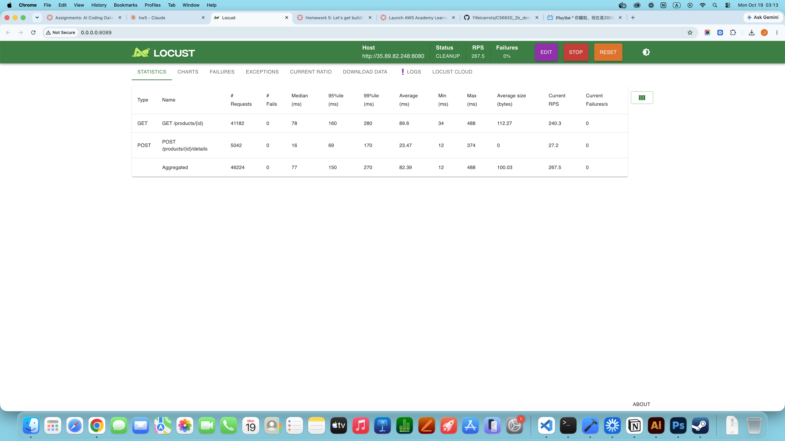
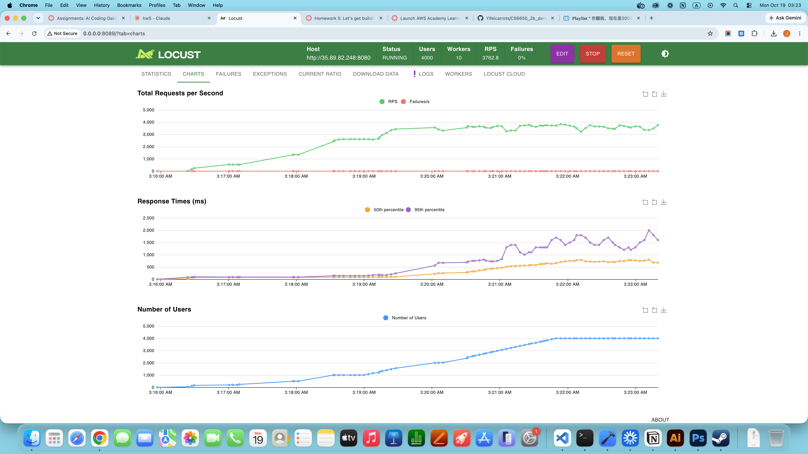
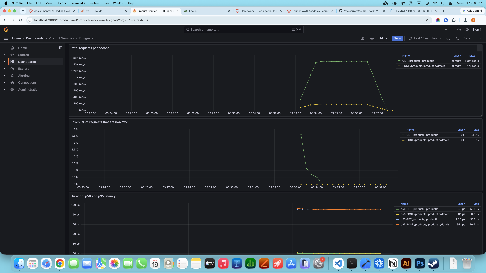
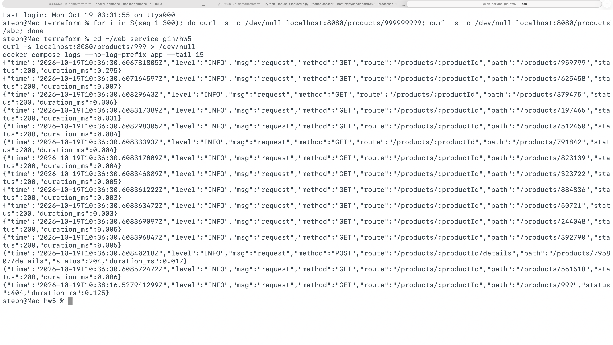

# Product API on AWS ECS (Terraform)

This repo contains the **Product API** (a Go + Gin server implementing the Product endpoints of the provided OpenAPI spec), the **Terraform** code that deploys it to **AWS ECS Fargate**, a **Locust** load test, and a local **Prometheus + Grafana** observability stack.

One `terraform apply` builds the Docker image, pushes it to ECR, and creates the networking, logging, and ECS service needed to run it. No clicking through the AWS console required.

## Where things are

```
.
├── src/                      # Server code + Dockerfile
│   ├── product-service.go    #   Gin server: endpoints, validation, in-memory store,
│   │                         #   Prometheus metrics (/metrics) and JSON request logs
│   ├── go.mod / go.sum       #   Go dependencies
│   └── Dockerfile            #   Multi-stage build (cross-compiles for linux/amd64)
├── terraform/                # Infrastructure as code
│   ├── provider.tf           #   AWS and Docker providers, ECR login
│   ├── variables.tf          #   Settings: region, names, port, task count
│   ├── main.tf               #   Wires the modules together, builds and pushes the image
│   ├── outputs.tf            #   Prints the ECS cluster and service names
│   └── modules/
│       ├── network/          #   Security group (opens the container port)
│       ├── ecr/              #   Image repository
│       ├── logging/          #   CloudWatch log group
│       └── ecs/              #   Cluster, task definition, and service
├── locust/
│   └── locustfile.py         # Load test (HttpUser and FastHttpUser variants)
├── observability/            # Local Prometheus + Grafana stack (Part V)
│   ├── docker-compose.yml
│   ├── prometheus.yml
│   └── grafana/              #   Auto-provisioned data source and RED dashboard
└── screenshots/              # Load test, dashboard, and log screenshots
```

## Prerequisites

- **Docker Desktop**, **running** before you deploy (Terraform builds the image locally).
- **Terraform** (a recent version) and **AWS CLI v2**.
- **AWS Learner's Lab** access. The Terraform code reuses the lab's pre-created `LabRole` IAM role; on a regular AWS account you would need to provide a role with ECS task-execution permissions instead.
- For load testing: **Python 3** and **Locust** (`pip install locust`, ideally in a virtual environment).

Check installs with `docker --version`, `terraform -version`, and `aws --version`.

## 1. Clone the repo

```bash
git clone https://github.com/Yifeicarrots/CS6650_2b_demo.git
cd CS6650_2b_demo
```

## 2. Set up AWS credentials

Start your Learner's Lab session, open **AWS Details**, and click **Show** next to *AWS CLI*. Then run `aws configure` and enter the access key, secret key, region `us-west-2`, and output `json`. If it does not prompt for the session token, add it with:

```bash
aws configure set aws_session_token <YOUR-SESSION-TOKEN>
```

Confirm with `aws sts get-caller-identity`. Lab credentials are temporary, so repeat this step whenever your lab session restarts.

## 3. Deploy

```bash
cd terraform
terraform init
terraform apply -auto-approve
```

On a Mac, if this fails with `Cannot connect to the Docker daemon at unix:///var/run/docker.sock`, run this first in the same terminal (see Troubleshooting):

```bash
export DOCKER_HOST=unix://$HOME/.docker/run/docker.sock
```

## 4. Find the server's public IP

Wait about a minute after `apply` finishes, then run from `terraform/`:

```bash
CLUSTER=$(terraform output -raw ecs_cluster_name)
SERVICE=$(terraform output -raw ecs_service_name)

TASK=$(aws ecs list-tasks --cluster "$CLUSTER" --service-name "$SERVICE" \
  --query 'taskArns[0]' --output text)

ENI=$(aws ecs describe-tasks --cluster "$CLUSTER" --tasks "$TASK" \
  --query "tasks[0].attachments[0].details[?name=='networkInterfaceId'].value" --output text)

IP=$(aws ec2 describe-network-interfaces --network-interface-ids "$ENI" \
  --query 'NetworkInterfaces[0].Association.PublicIp' --output text)

echo $IP
```

The IP changes whenever the task restarts or is redeployed.

## 5. Send requests

The server listens on port **8080**.

| Method | Path | Description | Responses in spec |
|---|---|---|---|
| `GET` | `/products/{productId}` | Get a product by ID | `200`, `404`, `500` |
| `POST` | `/products/{productId}/details` | Add or update a product | `204`, `400`, `404`, `500` |

A product has six required fields: `product_id` (≥ 1, must match the ID in the URL), `sku` (1–100 characters), `manufacturer` (1–200 characters), `category_id` (≥ 1), `weight` (≥ 0, grams), and `some_other_id` (≥ 1). Errors return JSON with `error`, `message`, and `details`.

### Examples for every response code

Run these in the same terminal as step 4 so `$IP` is set. The store starts empty and lives in memory, so run the first one first.

**204 No Content**: add a valid product

```bash
curl -i -X POST http://$IP:8080/products/1/details \
  -H "Content-Type: application/json" \
  -d '{"product_id":1,"sku":"ABC-123","manufacturer":"Acme","category_id":2,"weight":500,"some_other_id":3}'
```
```
HTTP/1.1 204 No Content
```

**200 OK**: get an existing product

```bash
curl -i http://$IP:8080/products/1
```
```
HTTP/1.1 200 OK
{"product_id":1,"sku":"ABC-123","manufacturer":"Acme","category_id":2,"weight":500,"some_other_id":3}
```

**400 Bad Request**: missing a required field

```bash
curl -i -X POST http://$IP:8080/products/2/details \
  -H "Content-Type: application/json" \
  -d '{"product_id":2,"sku":"ABC-123","manufacturer":"Acme","category_id":2,"some_other_id":3}'
```
```
HTTP/1.1 400 Bad Request
{"error":"INVALID_INPUT","message":"The provided input data is invalid","details":"weight is required"}
```

**400 Bad Request**: value below its minimum

```bash
curl -i -X POST http://$IP:8080/products/2/details \
  -H "Content-Type: application/json" \
  -d '{"product_id":2,"sku":"ABC-123","manufacturer":"Acme","category_id":0,"weight":500,"some_other_id":3}'
```
```
HTTP/1.1 400 Bad Request
{"error":"INVALID_INPUT","message":"The provided input data is invalid","details":"category_id must be at least 1"}
```

**400 Bad Request**: malformed JSON

```bash
curl -i -X POST http://$IP:8080/products/2/details \
  -H "Content-Type: application/json" \
  -d '{"product_id": 2, oops'
```
```
HTTP/1.1 400 Bad Request
{"error":"INVALID_INPUT","message":"Request body must be valid JSON matching the Product schema","details":"invalid character 'o' looking for beginning of object key string"}
```

**400 Bad Request**: body ID does not match URL ID

```bash
curl -i -X POST http://$IP:8080/products/2/details \
  -H "Content-Type: application/json" \
  -d '{"product_id":9,"sku":"ABC-123","manufacturer":"Acme","category_id":2,"weight":500,"some_other_id":3}'
```
```
HTTP/1.1 400 Bad Request
{"error":"INVALID_INPUT","message":"The provided input data is invalid","details":"product_id in body (9) does not match productId in URL (2)"}
```

**404 Not Found**: product does not exist

```bash
curl -i http://$IP:8080/products/999
```
```
HTTP/1.1 404 Not Found
{"error":"PRODUCT_NOT_FOUND","message":"Product not found","details":"No product exists with ID 999"}
```

**404 Not Found**: invalid ID on GET

```bash
curl -i http://$IP:8080/products/abc
```
```
HTTP/1.1 404 Not Found
{"error":"PRODUCT_NOT_FOUND","message":"Product not found","details":"Product ID must be a positive 32-bit integer"}
```

All of these were verified with `go run`, in a local Docker container, and against the deployed ECS service.

### Design decisions and codes that cannot be triggered

- **Invalid IDs on GET return `404`**, because the spec lists no `400` for GET and no product can have such an ID. On POST, which does list `400`, an invalid ID returns `400`.
- **POST adds or updates** (the spec describes it as "Add or update"). There is no separate create endpoint, so POST creates the product when it does not exist. As a result, **POST's `404` is never returned**.
- **`500`** is produced by a recovery middleware that catches any panic in a handler and returns an `Error`-schema body. With a simple in-memory map there is no natural failure that causes it, so it cannot be triggered by a normal request.
- Request bodies are decoded into a struct with **pointer fields**, so a missing field (`nil`) can be told apart from a field sent as `0`. This matters for `weight`, which is required but may be `0`.

## 6. Redeploy after changing the code

```bash
terraform apply -auto-approve
aws ecs update-service --cluster "$CLUSTER" --service "$SERVICE" --force-new-deployment
```

The image is always tagged `latest`, so ECS does not notice a new image on its own; forcing a new deployment makes it pull the new one. Then repeat step 4.

## 7. Clean up

```bash
cd terraform
terraform destroy -auto-approve
```

Run it from the `terraform/` folder. From any other folder, Terraform finds no state and destroys nothing.

---

## Load testing (Part IV)

### Test design

- **Request mix: 90% GET, 10% POST** (task weights 9:1). In a store, people browse products far more often than products are added or updated.
- Each simulated user **creates 5 products first** (`on_start`) and then reads products it knows exist, so GETs measure real lookups (200) rather than misses (404).
- **Wait time 0.1–0.5 s** between requests per user, so throughput is roughly `users / (0.3 s + latency)`.
- `name=` groups all product IDs into one row per endpoint in the statistics.
- The two user classes share the same task set, so **HttpUser and FastHttpUser send identical traffic**.
- The stress test uses `--processes -1` (one Locust worker per CPU core) so the load generator itself does not become the bottleneck.

Run against the deployed service:

```bash
locust -f locust/locustfile.py ProductHttpUser --host http://$IP:8080
locust -f locust/locustfile.py ProductFastUser --host http://$IP:8080
locust -f locust/locustfile.py ProductFastUser --host http://$IP:8080 --processes -1
```

### HttpUser vs FastHttpUser (100 users, ramp-up 10/s, ~3 minutes each)

| | HttpUser | FastHttpUser |
|---|---|---|
| Total RPS | 250.7 | 267.5 |
| Failures | 0% | 0% |
| GET median / p95 / p99 | 17 / 28 / 250 ms | 78 / 160 / 280 ms |
| POST median / p95 / p99 | 18 / 42 / 200 ms | 16 / 69 / 170 ms |




**Findings.**

- **Throughput was about the same.** At this load, throughput is capped by the test design (100 users each waiting 0.1–0.5 s), not by either client. FastHttpUser's advantage is lower CPU use per request *on the load generator*, which only matters when the load generator is CPU-bound. At 100 users it was not, so there was nothing to gain.
- **Latency was dominated by the network.** The minimum response time (~12 ms) is roughly the round trip from Vancouver to the `us-west-2` (Oregon) data center; the in-memory server itself answers in microseconds (see Part V).
- **GET latency was higher with FastHttpUser while POST was not.** Server and network were identical for both runs, and POST was unaffected, so the extra time points to the client side: how `geventhttpclient` (used by FastHttpUser) handles the response. One difference between the endpoints is that GET returns a JSON body while POST returns `204` with no body. Timing a single GET directly with `curl -w "%{time_total}"` separates server + network time from client-library overhead.

### Stress test (FastHttpUser, 10 worker processes)

Users were raised in steps (200 → 500 → 1,000 → 2,000 → 4,000), about a minute per step.

| Users | RPS | p50 | p95 |
|---|---|---|---|
| 200 | ~550 | ~75 ms | ~90 ms |
| 500 | ~1,350 | ~75 ms | ~90 ms |
| 1,000 | ~2,600 | ~85 ms | ~140 ms |
| ~1,500 | ~3,350 | ~95 ms | ~200 ms |
| 2,000–4,000 | **plateau ~3,500–3,800** | ~750 ms | 1,500–2,000 ms |



**Where it struggled and why.**

- Up to ~1,000 users, RPS grew in line with users (1,000 / 0.385 s ≈ 2,600 RPS, matching the measurement), so the server kept up.
- The first warning sign was the **tail**: p95 more than doubled (90 → 200 ms) while the median barely moved, meaning some requests started waiting in a queue.
- Between ~1,500 and 2,000 users, **RPS stopped rising** (peaking around 3,760) even as users doubled to 4,000, while the median rose to ~750 ms and p95 to 1.5–2 s. That is the saturation point.
- There were **0 failures**: the server did not crash or reject requests; extra requests queued instead. This matches **Little's Law**: at 4,000 users and ~3,700 RPS, each user's cycle takes 4,000 / 3,700 ≈ 1.08 s; minus the 0.3 s average wait, that leaves ~0.78 s of latency, which matches the ~750 ms median.
- The likely bottleneck is the CPU of the small Fargate task; the ECS service's CPU utilization metric (ECS console → service → Health and metrics) confirms whether it was pinned near 100%.

### Tradeoffs

- **Which operations are most common?** Reads (GET) far outnumber writes in a store. The data structure is a Go **map** (fast lookups by ID) protected by a **`sync.RWMutex`**, which lets many reads run in parallel and only gives writers exclusive access. That fits a read-heavy workload well.
- **If writes became common,** every write would block all readers, causing lock contention. Options then include splitting the map into shards (each with its own lock) or moving to a real database.
- **In-memory storage** makes requests fast but loses all data on restart and cannot be shared between multiple tasks, so it would not survive scaling to `ecs_count > 1`.

---

## Observability (Part V)

### What is measured

For every endpoint, the server tracks the **RED** signals in `src/product-service.go`:

- **Rate**: `http_requests_total` counter, labeled by method, route, and status.
- **Errors**: `http_request_errors_total` counter for non-2xx responses.
- **Duration**: `http_request_duration_seconds` histogram (p50/p95 computed in Grafana).

They are exposed at `/metrics` via `promhttp`. Labels use the **route template** (`/products/:productId`), not the raw path, so every product ID shares one time series instead of creating millions (high cardinality).

The same data is also written as **one structured JSON log line per request** (method, route, path, status, duration).

### Run it locally

```bash
cd observability
docker compose up --build
```

- App: http://localhost:8080 (metrics at http://localhost:8080/metrics)
- Prometheus: http://localhost:9090
- Grafana: http://localhost:3000 → Dashboards → **Product Service - RED Signals** (data source and dashboard are provisioned automatically)

Generate load from another terminal:

```bash
locust -f locust/locustfile.py ProductFastUser --host http://localhost:8080 --processes -1
```

Stop everything with Ctrl+C, then `docker compose down`.

### Dashboard: idle vs. loaded

The run below shows ~10 minutes idle, then ~4 minutes of load (500 users, FastHttpUser) plus a burst of invalid requests (`/products/999999999` and `/products/abc`) to exercise the error panel, then idle again.



- **Rate:** no data while idle (no requests counted yet), then ~1,500 GET/s and ~170 POST/s under load (the 9:1 mix), then back to 0. The drop is gradual because the panel uses a 1-minute `rate()` window.
- **Errors:** a spike to ~3.6% on GET from the invalid-request burst, back to 0% afterwards; POST stays at 0%.
- **Duration:** p50 ≈ 50 µs and p95 ≈ 95 µs locally, versus 17+ ms against AWS, which shows how much of the AWS latency was network. These values are estimates: the smallest histogram bucket is 0–100 µs and nearly all requests fall in it, so `histogram_quantile` interpolates (exactly half and 95% of 100 µs). The accurate reading is "almost all requests finished in under 100 µs"; finer buckets starting around 10 µs would fix it. Duration lines end (rather than drop to 0) when traffic stops, because there are no requests to compute percentiles from.

### Request log excerpt (same run)

```
{"time":"2026-10-19T10:36:30.607164597Z","level":"INFO","msg":"request","method":"GET","route":"/products/:productId","path":"/products/625458","status":200,"duration_ms":0.007}
{"time":"2026-10-19T10:36:30.608298305Z","level":"INFO","msg":"request","method":"GET","route":"/products/:productId","path":"/products/512450","status":200,"duration_ms":0.004}
{"time":"2026-10-19T10:36:30.60840218Z","level":"INFO","msg":"request","method":"POST","route":"/products/:productId/details","path":"/products/795807/details","status":204,"duration_ms":0.017}
{"time":"2026-10-19T10:36:30.608572472Z","level":"INFO","msg":"request","method":"GET","route":"/products/:productId","path":"/products/561518","status":200,"duration_ms":0.006}
{"time":"2026-10-19T10:38:16.527941299Z","level":"INFO","msg":"request","method":"GET","route":"/products/:productId","path":"/products/999","status":404,"duration_ms":0.125}
```



View them with `docker compose logs --no-log-prefix app --tail 15`.

### Dashboard vs. logs

I would look at the **dashboard** to monitor the system's health in real time and notice when something changes, such as during a load test or right after a deploy: it shows at a glance whether request rate, error rate, or latency have shifted, but only as aggregates. I would look at the **logs** to investigate after the fact: when the dashboard shows an error spike or a latency jump, the logs show exactly which requests failed or were slow, with their path, status code, and precise duration. For example, the dashboard could only show that requests finished in under 100 µs, while the logs show individual requests taking 4–7 µs.

---

## Troubleshooting

- **`Cannot connect to the Docker daemon`**: Docker Desktop is not running. Start it and retry.
- **`Error pinging Docker server: Cannot connect to the Docker daemon at unix:///var/run/docker.sock`** (Mac, Docker Desktop running): Terraform's Docker provider looks at the standard Linux socket location, but Docker Desktop uses a different one. Run `export DOCKER_HOST=unix://$HOME/.docker/run/docker.sock` in the same terminal before `terraform apply`, or enable **Settings → Advanced → "Allow the default Docker socket to be used"** in Docker Desktop.
- **`ExpiredToken` or other credential errors**: lab credentials expired. Repeat step 2.
- **Requests hang or time out**: the task may still be starting, or it restarted with a new IP. Rerun step 4, and check the logs in **CloudWatch → Log groups → `/ecs/CS6650L2`**.
- **No task running a few minutes after the first `apply`**: Terraform can create the ECS service and push the image in parallel, so the first task may start before the image exists. ECS normally retries; if not, use the force-new-deployment command from step 6.
- **Task keeps stopping with `exec format error`**: CPU architecture mismatch. ECS here runs x86 (`amd64`), so `src/Dockerfile` cross-compiles with `GOARCH=amd64` and uses an `amd64` base image, which lets the image work even when built on an Apple Silicon Mac. Keep both settings if you change the Dockerfile.
- **`quote>` prompt after pasting commands** (zsh on Mac): zsh does not treat `#` as a comment by default when pasting, so an apostrophe in a comment line opens a quote. Press Ctrl+C and paste without comment lines, or run `setopt interactivecomments` first.
- **`destroy` reports 0 resources**: you are not in the `terraform/` folder.
